# Gas Turbine Maintenance Assistant

**Project 3 — RAG over GE GER-3620P, *Heavy-Duty Gas Turbine Operating and Maintenance Considerations* (Rev P, 60 pages).**

Ask an operating or maintenance question about GE heavy-duty gas turbines and get an answer drawn only from the
document, with the **section and page where the answer is**. If the document does not contain the answer, the
assistant replies **`Not found`**.

**Stack:** Python 3.12 · LangChain · ChromaDB · FastEmbed (local ONNX embeddings + cross-encoder reranker) · BM25 · PyMuPDF · Groq (`openai/gpt-oss-120b`) · Streamlit web UI

**Contents:** [Answers](#answers-to-the-5-questions) · [Screenshots](#screenshots-question-asked-and-answer) · [Terminal demo](#live-demo-in-the-terminal) · [Web UI](#web-ui-runs-on-localhost) · [Flow](#flow) · [Evaluation](#evaluation) · [Setup](#setup-and-run)

---

## Answers to the 5 questions

| # | Question | Answer (from the system) | Where in the document |
|---|---|---|---|
| 1 | What are the three main types of inspection? | **Standby, running, and disassembly inspections.** | *Maintenance Inspections*, p. 21 (PDF p. 25) |
| 2 | What does a maintenance factor of two mean? | **The maintenance interval is one-half of the baseline interval**, i.e. maintenance is needed twice as often as under baseline conditions. | *Major Factors Influencing Maintenance and Equipment Life*, p. 4-5 (PDF p. 8-9) |
| 3 | What is the purchase price of this gas turbine? | **Not found** | — (the document has no pricing) |
| 4 | What is the melting point of titanium? | **Not found** | — (not covered by the document) |
| 5 | What is the recommended combustion-inspection interval in hours? | **It depends on the model and combustion system: 8,000 to 32,000 factored hours** (baseline: base load, natural gas, dry). 8,000 h: 7E.03, 9E.03, 6F.03 (non-DLN) · 12,000 h: 6B.03, 7E.03 and 9E.03 (DLN), 9F.05 · 24,000 h: 6F.03 (DLN), 7F.03, 7F.05, 9F.03 · 25,000 h: 7HA.01/.02, 9HA.01/.02 · 32,000 h: 9E.04, 6F.01, 7F.04, 7FB.04, 9F.04 | *Inspection Intervals*, **Figure 36**, p. 29 (PDF p. 33) |

> **Page numbers:** "p." is the number printed on the page; "PDF p." is the page number shown by a PDF viewer.
> Raw system output for all five questions: [`answers.md`](answers.md).

### Short answers for the LMS form

```text
1. Standby, running, and disassembly inspections. (Maintenance Inspections, p. 21 / PDF p. 25)
2. The maintenance interval becomes half of the baseline interval, so maintenance is needed twice as often. (Major Factors Influencing Maintenance and Equipment Life, p. 5 / PDF p. 9)
3. Not found
4. Not found
5. Model-dependent: 8,000 to 32,000 factored hours (Figure 36, base load/natural gas/dry). E.g. 7E.03 and 9E.03: 8,000 h non-DLN, 12,000 h DLN; 6B.03: 12,000 h; 7F.03 and 9F.03: 24,000 h; 7HA/9HA: 25,000 h; 7F.04 and 9F.04: 32,000 h. (Inspection Intervals, Figure 36, p. 29 / PDF p. 33)
```

---

## Screenshots: question asked and answer

Captured from `python ask.py --file questions.txt --screenshots screenshots`. Each one shows the question, the
answer, the reference and the model that produced it.

**Q1. What are the three main types of inspection?**

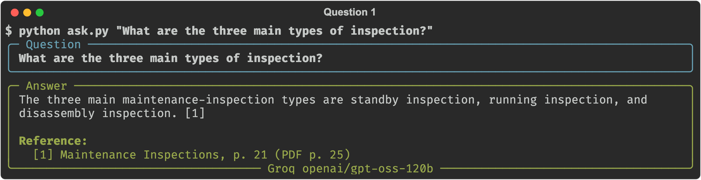

**Q2. What does a maintenance factor of two mean?**

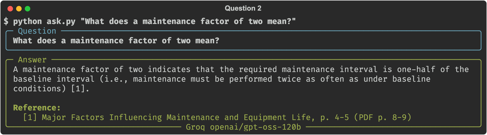

**Q3. What is the purchase price of this gas turbine?** (not in the document)

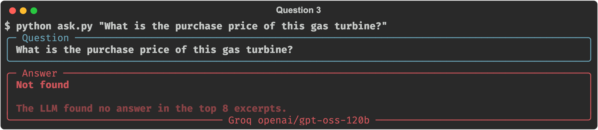

**Q4. What is the melting point of titanium?** (not in the document)

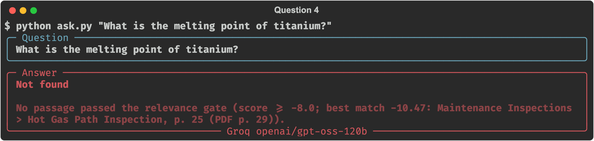

**Q5. What is the recommended combustion-inspection interval in hours?**

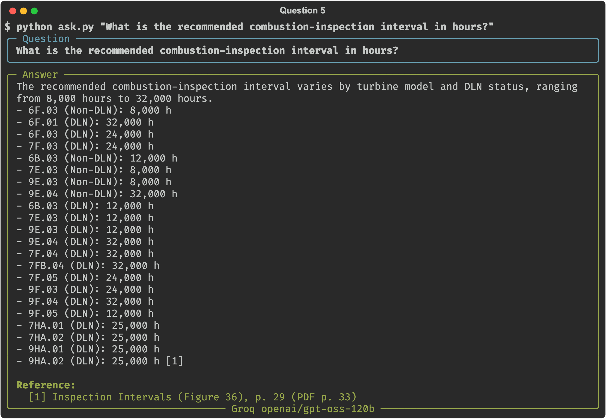

---

## Live demo in the terminal

These are recordings of real terminal sessions of the assistant running. They show more than the 5 required
questions: a multi-question conversation, what the retriever found, and the automated test run.

### 1. Interactive session

Running `python ask.py` with no arguments starts a chat-style session. Here three questions are asked in a row; the
last one is not in the document, so the assistant answers `Not found` instead of guessing.

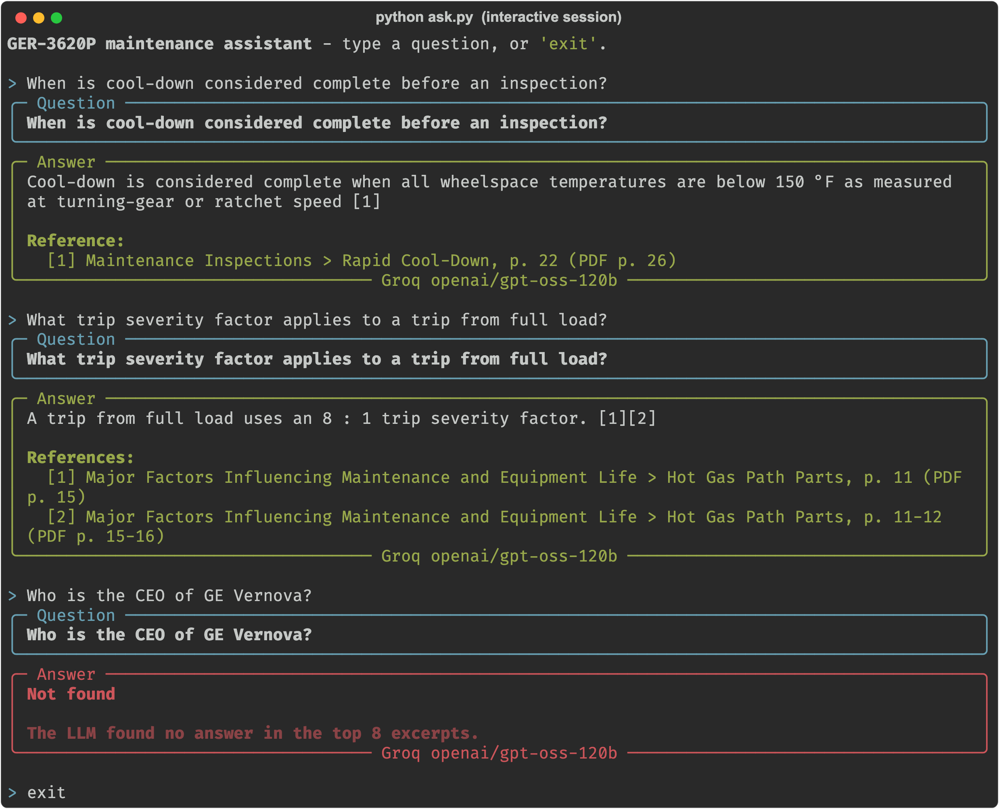

### 2. Under the hood: what the retriever found

`--show-context` also prints the excerpts that were sent to the LLM, ranked by the cross-encoder score. The answer
comes from the Figure 36 table chunks. Hybrid search (vectors + BM25) found them even though the table is mostly
numbers.

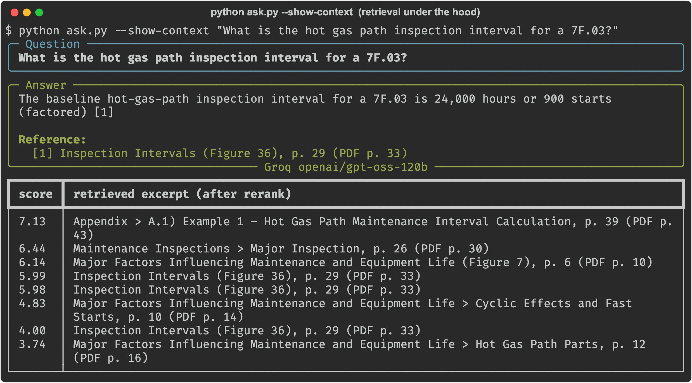

### 3. Evaluation run

`python eval.py` asks 11 questions: 6 answerable and 5 not in the PDF. For an answerable question it checks the facts
**and** the cited page. For one that is not in the PDF it checks for an exact `Not found`.

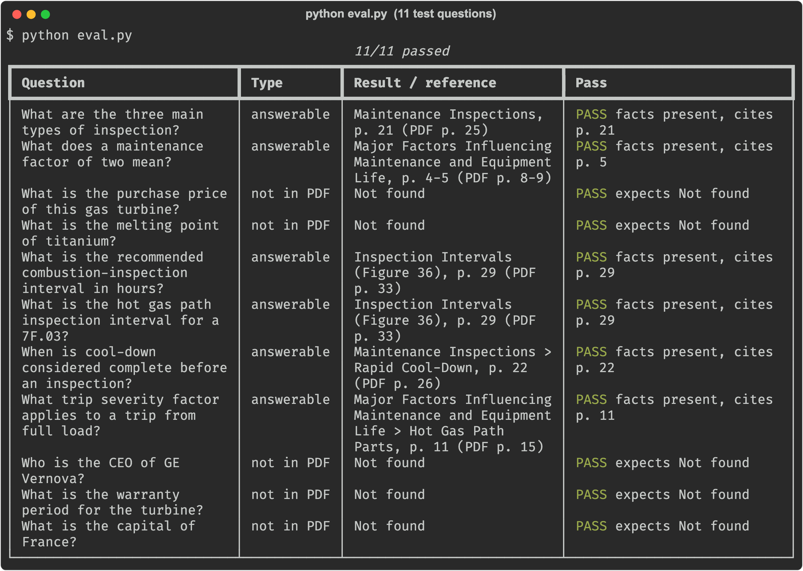

---

## Web UI (runs on localhost)

A chat-style web app built with **Streamlit** on top of the same RAG pipeline.

```bash
streamlit run app.py        # opens http://localhost:8501
```

- Ask any question, or click one of the 5 assignment questions.
- Answers have numbered citations and a **Sources** list with section, figure and page.
- Questions the PDF doesn't answer get a red **Not found** card instead of a guess.
- **How this answer was found** shows the relevance-gate decision and every retrieved excerpt with its rerank score.

**Home screen**

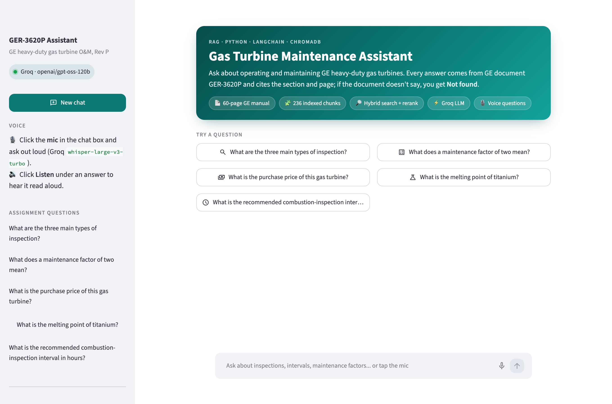

**The 5 assignment questions in the web UI** (click an image to see it full size)

<table>
  <tr>
    <td width="50%" valign="top"><b>Q1</b> · Three main types of inspection<br><br>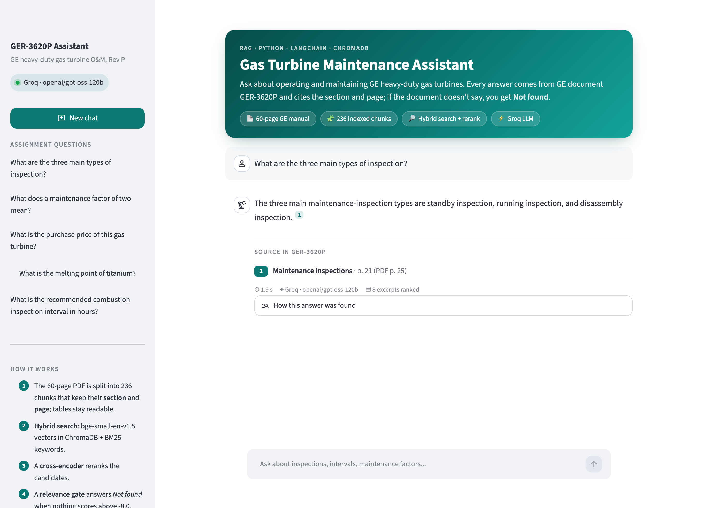</td>
    <td width="50%" valign="top"><b>Q2</b> · Maintenance factor of two<br><br>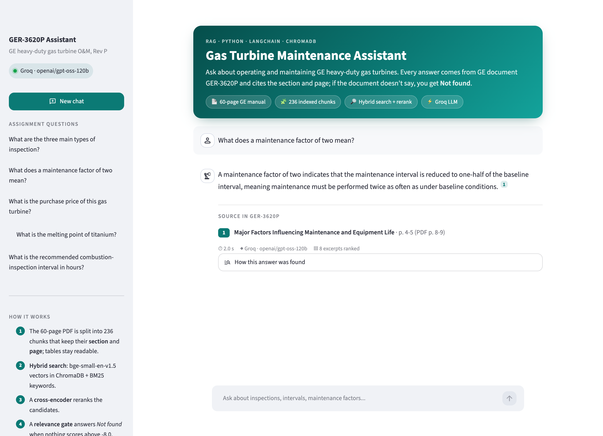</td>
  </tr>
  <tr>
    <td width="50%" valign="top"><b>Q3</b> · Purchase price → <b>Not found</b><br><br>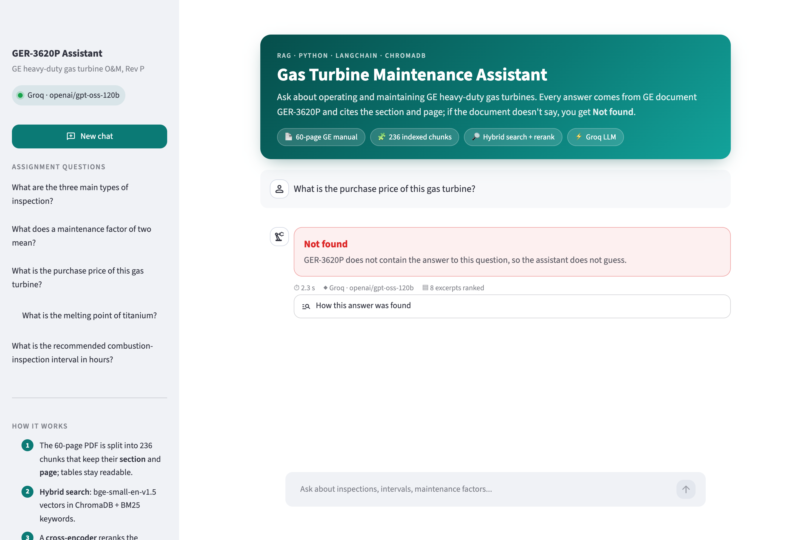</td>
    <td width="50%" valign="top"><b>Q4</b> · Melting point of titanium → <b>Not found</b><br><br>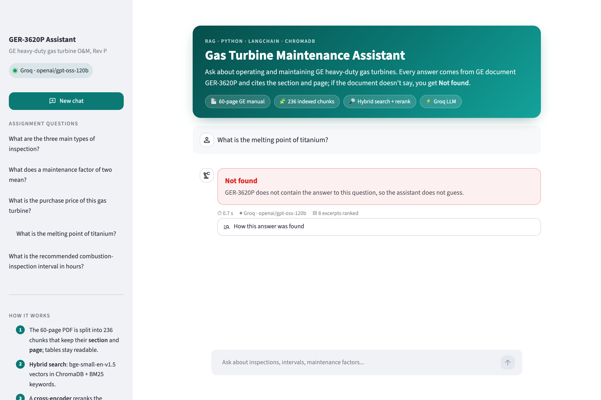</td>
  </tr>
  <tr>
    <td colspan="2" valign="top"><b>Q5</b> · Recommended combustion-inspection interval, answered from the Figure 36 table<br><br>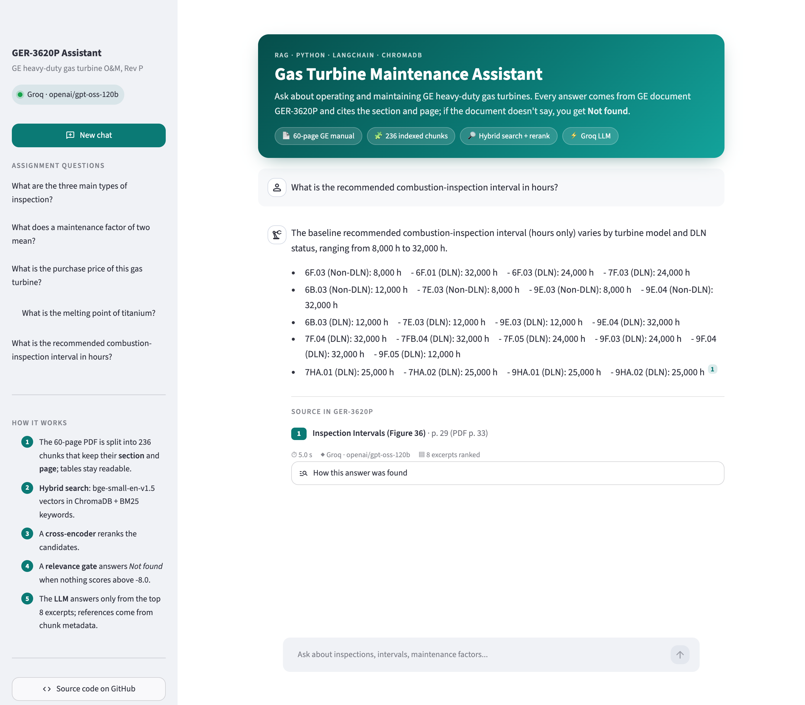</td>
  </tr>
</table>

<details>
<summary><b>Under the hood:</b> "How this answer was found", expanded for Q1</summary>
<br>
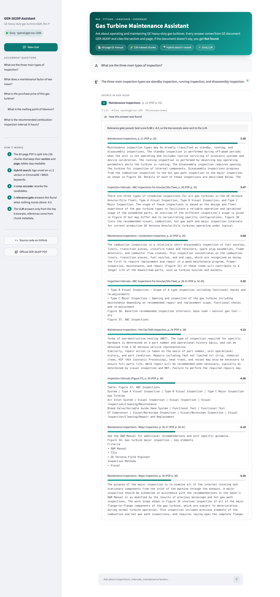
</details>

---

## Flow

**1. Ingestion** (`python ingest.py`, run once)

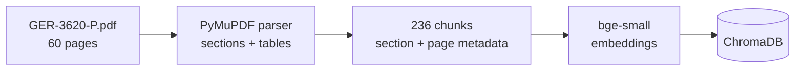

**2. Question answering** (`python ask.py`)

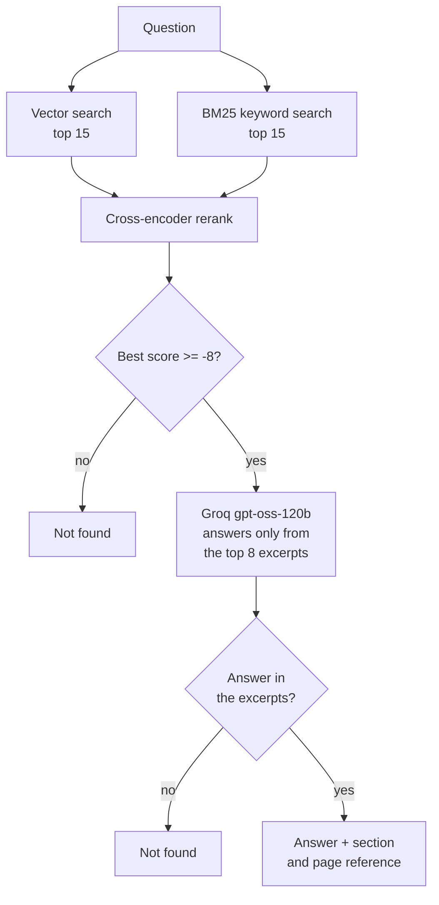

### Step by step

1. **Parse the PDF with its structure.** The PDF has no bookmarks, so `pdf_loader.py` rebuilds the heading tree from
   typography: 14 pt teal = section, 10 pt = subsection, 9 pt teal = minor heading. SemiBold figure titles and the
   25 pt title banner are excluded. The cover, table of contents, list of figures, revision history, and running
   headers and footers are skipped.
2. **Keep tables readable.** Plain text extraction turns Figure 36 (the inspection-interval matrix) into an unlabelled
   stream of numbers. Instead, each table is detected with `page.find_tables()` and read cell by cell, and every value
   is written with the model it belongs to:
   `Combustion (DLN) | Factored | 6B.03: 12000/450 | 7E.03: 12000/450 | 9E.03: 12000/450 | 9E.04: 32000/900`.
3. **Chunk and index.** Text is split with LangChain's `RecursiveCharacterTextSplitter`. Each chunk is prefixed with
   its section path, so both the embedding and the LLM know the context. Every chunk stores `section`, `figure`,
   printed page and PDF page as metadata, and is stored in **ChromaDB**.
4. **Hybrid retrieval.** Dense vectors catch paraphrases ("disassembly inspection" vs "opening the turbine").
   **BM25** catches exact identifiers such as `7F.03` that embeddings blur.
5. **Rerank.** A cross-encoder rescores every candidate against the question, and the best 8 go to the LLM.
6. **"Not found" in two layers.**
   - **Relevance gate:** when no excerpt scores above the threshold (for example "melting point of titanium", best
     score about -10.5), the system answers `Not found` without calling the LLM.
   - **Grounded LLM:** the prompt allows only the numbered excerpts as evidence and requires the exact reply
     `Not found` otherwise. "Purchase price" scores just above the gate (about -6.3), so it reaches the LLM, which
     finds no price in the excerpts and answers `Not found`.
7. **References come from metadata, not from the LLM.** The LLM only writes tags like `[1]`. The code maps each tag
   back to its chunk and prints that chunk's stored section and page, so a reference can never be invented.

---

## Evaluation

`python eval.py` runs the 5 assignment questions plus 6 extra ones. For an answerable question it checks that the
answer contains the expected facts **and** cites the correct page. For an unanswerable one it checks for an exact
`Not found`.

**11/11 passed**

| Question | Type | Result / reference | Check |
|---|---|---|---|
| What are the three main types of inspection? | answerable | Maintenance Inspections, p. 21 (PDF p. 25) | PASS: facts present, cites p. 21 |
| What does a maintenance factor of two mean? | answerable | Major Factors Influencing Maintenance and Equipment Life, p. 4-5 (PDF p. 8-9) | PASS: facts present, cites p. 5 |
| What is the purchase price of this gas turbine? | not in PDF | Not found | PASS |
| What is the melting point of titanium? | not in PDF | Not found | PASS |
| What is the recommended combustion-inspection interval in hours? | answerable | Inspection Intervals (Figure 36), p. 29 (PDF p. 33) | PASS: facts present, cites p. 29 |
| What is the hot gas path inspection interval for a 7F.03? | answerable | Inspection Intervals (Figure 36), p. 29 (PDF p. 33) | PASS: facts present, cites p. 29 |
| When is cool-down considered complete before an inspection? | answerable | Maintenance Inspections > Rapid Cool-Down, p. 22 (PDF p. 26) | PASS: facts present, cites p. 22 |
| What trip severity factor applies to a trip from full load? | answerable | Major Factors Influencing Maintenance and Equipment Life > Hot Gas Path Parts, p. 11 (PDF p. 15) | PASS: facts present, cites p. 11 |
| Who is the CEO of GE Vernova? | not in PDF | Not found | PASS |
| What is the warranty period for the turbine? | not in PDF | Not found | PASS |
| What is the capital of France? | not in PDF | Not found | PASS |

---

## Project structure

```text
.
├── config.py          # paths, model names, chunking and retrieval settings
├── pdf_loader.py      # PDF -> section-aware text and table chunks with page metadata
├── ingest.py          # builds the ChromaDB index (chroma_db/)
├── rag.py             # hybrid retrieval, rerank, relevance gate, Groq LLM, citations
├── ask.py             # CLI: one question, interactive mode, or batch + screenshots
├── app.py             # Streamlit web UI (streamlit run app.py)
├── .streamlit/        # web UI theme and settings
├── eval.py            # regression check (answerable + unanswerable questions)
├── questions.txt      # the 5 assignment questions
├── answers.md         # generated answers to the 5 questions
├── eval_results.md    # generated evaluation table
├── screenshots/       # q1-q5 answers + demo-* terminal sessions (.png, plus .svg captures)
├── data/              # put GER-3620-P.pdf here (not committed, see Setup)
├── requirements.txt
└── .env.example       # GROQ_API_KEY=...
```

## Setup and run

Requires Python 3.10-3.12 and a free Groq API key from [console.groq.com](https://console.groq.com/keys).

```bash
git clone https://github.com/adityamukesh/genai-aditya.git
cd genai-aditya
python3.12 -m venv .venv && source .venv/bin/activate
pip install -r requirements.txt

# The PDF (official GE Vernova copy)
curl -L -o data/GER-3620-P.pdf \
  "https://www.gevernova.com/content/dam/gepower-new/global/en_US/downloads/gas-new-site/resources/reference/GER-3620-P.pdf"

cp .env.example .env          # then put your GROQ_API_KEY in .env

python ingest.py              # parse, chunk, embed -> chroma_db/  (about 2 minutes, once)
python ask.py "What are the three main types of inspection?"
streamlit run app.py          # web UI at http://localhost:8501
```

Other ways to run it:

```bash
python ask.py                                   # interactive: ask question after question
python ask.py --show-context "What is a combustion inspection?"   # also show retrieved excerpts and scores
python ask.py --file questions.txt --report answers.md --screenshots screenshots
python eval.py                                  # 11-question check, writes eval_results.md
```

Without a `GROQ_API_KEY` the assistant still runs in an **extractive fallback** mode. It returns the
best-matching sentences of the top excerpt, with the same references and the same `Not found` gate.

## Notes

- **Models:** the embeddings (`BAAI/bge-small-en-v1.5`) and the reranker (`Xenova/ms-marco-MiniLM-L-6-v2`) run
  locally through FastEmbed/ONNX, so no GPU or PyTorch is needed. Only answer generation calls Groq.
  `GROQ_MODEL` in `.env` switches the model.
- **Rate limits:** the Groq free tier allows 8,000 tokens per minute. The client retries automatically when that
  limit is hit.
- **The PDF is not committed:** the GE document is marked *Non-Public* in its footer, so the repository links to the
  official download instead of redistributing it.
- **Wording:** LLM phrasing can vary slightly between runs. The facts and references are checked by `eval.py`.
